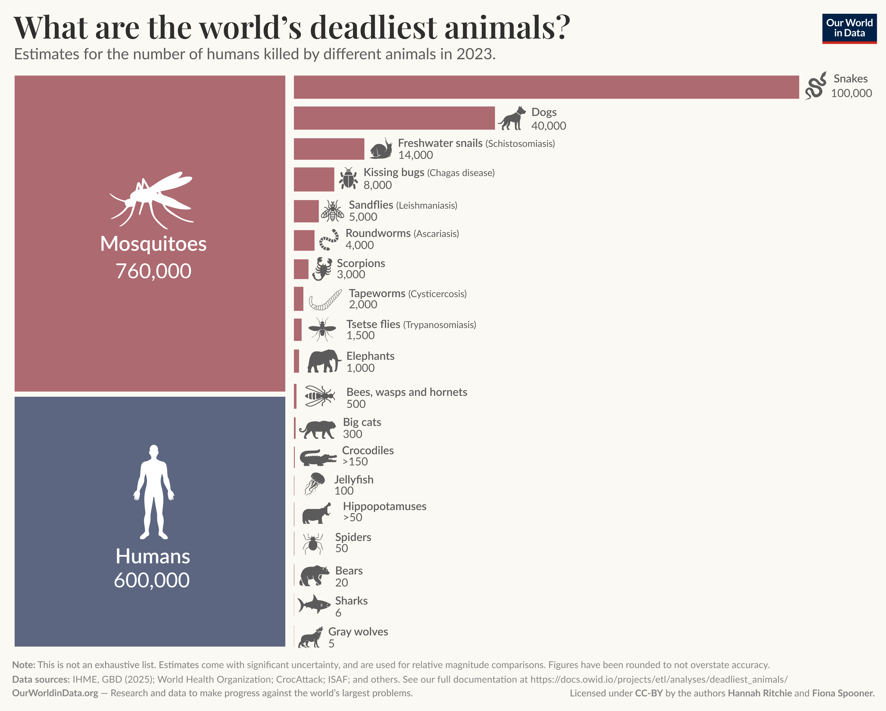
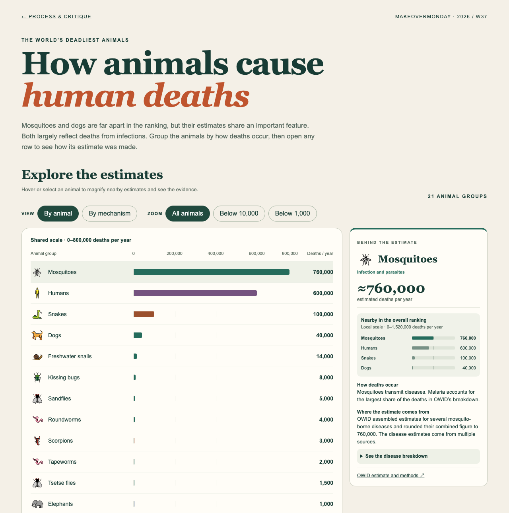
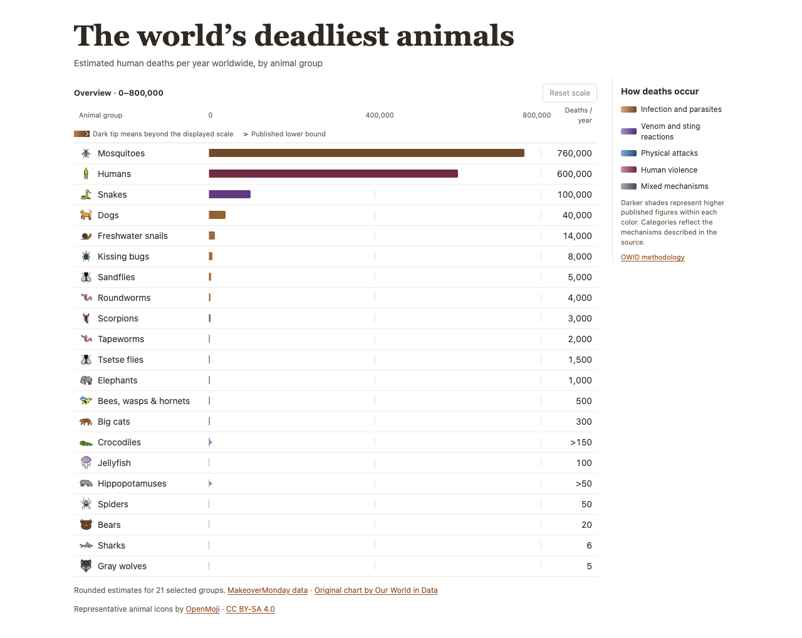

[Home](./) · [Critique by Design](critique-by-design.html)

# What are the world’s deadliest animals?

*MakeoverMonday 2026/W37*

## Original visualization

I chose this chart because the difference surprised me. The estimates range from about 760,000 deaths per year for mosquitoes to six for sharks. I wanted readers to see the overall gap and still be able to compare the smallest values. [Original article](https://ourworldindata.org/deadliest-animals) · [Challenge data](https://makeovermonday.vercel.app/dataset/what-are-the-world-s-deadliest-animals)

*Original graphic by Hannah Ritchie and Fiona Spooner for Our World in Data, CC BY.*

## Critique

The large blocks make mosquitoes and humans stand out. The animal silhouettes help readers find familiar entries. The colors distinguish mosquitoes from humans, but the chart gives no legend explaining the red and blue. The smallest bars, though, look like nearly identical lines. The design also switches from area to length, so comparing the two sections depends on reading the labels. Few’s criteria helped me separate the impact of the first impression from the ease of comparing values.

The chart uses rounded estimates and marks two lower bounds with “>”. The methods draw on several sources and periods. For example, the shark estimate comes from a decade of recorded deaths.

## Early prototype

The first interactive version had separate ranking and mechanism views. A side panel showed the selected animal’s estimate, a close-up of nearby values, and notes on the source.

## Peer testing and revisions

- **Participant A** suggested using less text. I removed the detailed explanations of how each animal causes deaths and kept the short labels in the legend.
- **Participant B** suggested showing the death estimates and mechanisms together. I combined the separate views into one chart. Bar length shows the estimate, and color shows the mechanism. A legend next to the chart explains the colors.

## Final redesign

[Open the interactive bar chart →](deadliest-animals-chart.html)

All 21 groups share one axis. Hovering over a row puts its displayed value at the midpoint and rescales the bars in place. A click holds the scale. Color identifies the mechanism described in the original source’s methods. Darker shades mark larger published figures within each color. The legend explains both, and the animal icons help readers find each row.

For example, selecting spiders puts 50 at the center and 100 at the right edge. The jellyfish bar reaches that edge. The crocodile bar also reaches it, with a dark arrow tip and its original “>150” label. The axis can change between selections, so bar lengths are comparable within the current view.

## AI and tools

I used OpenAI Codex to write the HTML, CSS, and JavaScript for the interactive chart. I also used Codex to look up the mechanisms described in the original chart’s Our World in Data methodology and use them to label the chart.

Both interactive versions use OpenMoji icons under CC BY-SA 4.0.
