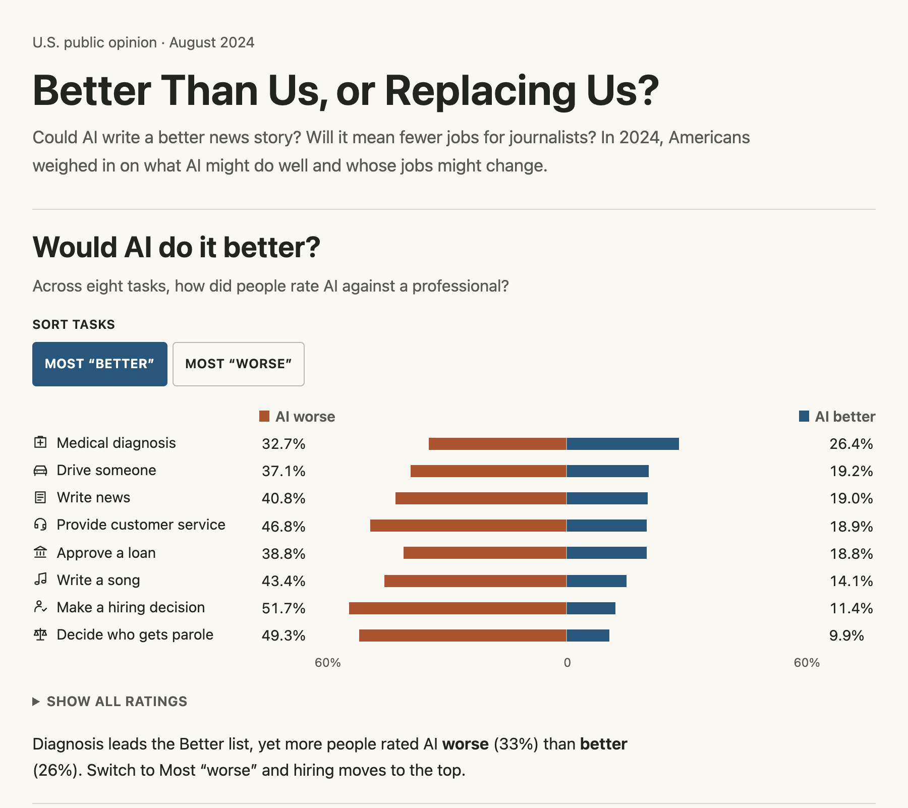
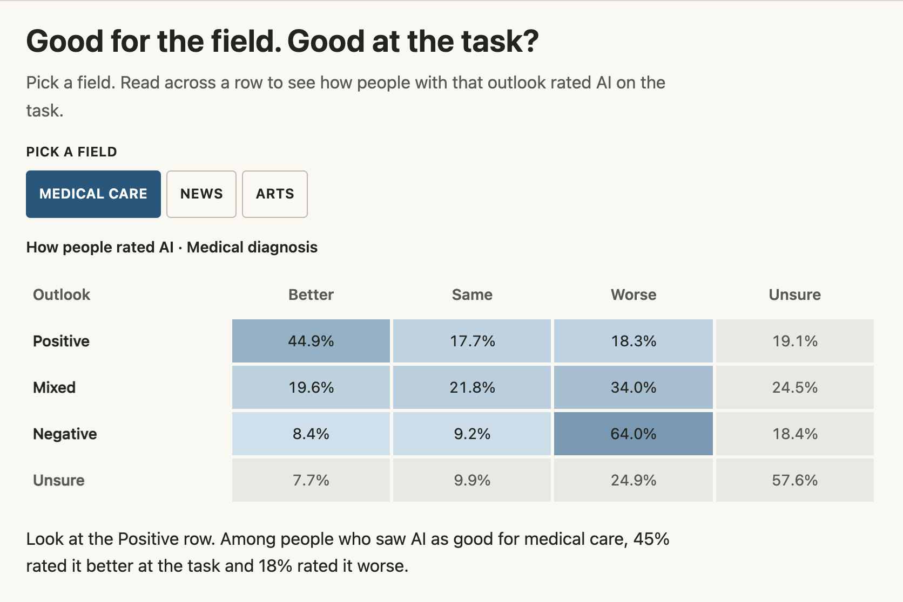
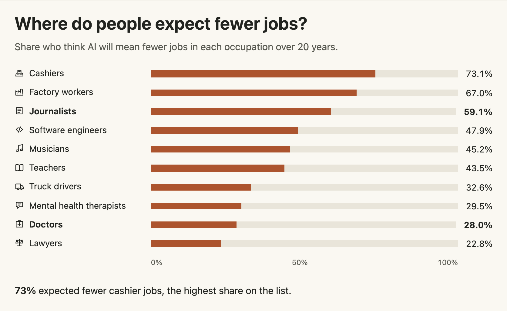
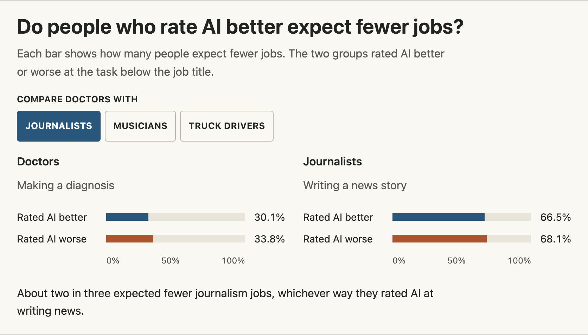
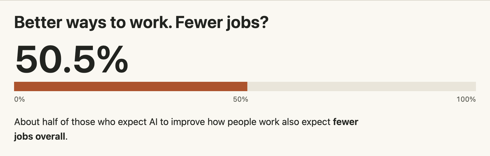

[Home](./) · [Examples & workshops](dataviz-examples.html) · [Critique by Design](critique-by-design.html) · [Final project](final-project-part-one.html)

---

# Final Project · Part I

## Better Than Us, or Replacing Us?

If people think AI could write a good news story, do they also expect fewer jobs for journalists? I wanted to see whether those two judgments go together. I’m writing for people who follow the conversation about AI and work, especially students thinking about their first jobs.

<a class="part-one-cover" href="better-than-us.html">
  Open the interactive prototype →
  
</a>

## What stood out

**People expected fewer jobs for journalists more often than for doctors.** In Pew’s August 2024 survey, 66.5% of the people who thought AI would write a better news story expected fewer journalism jobs. Among people who thought AI would write a worse story, it was 68.1%. For doctors, the two groups were much closer to one third.

**People could see AI improving work and still expect fewer jobs.** Among respondents who expected AI to improve how people do their jobs, 50.5% also expected fewer jobs overall.

## How the story will unfold

1. **Start with a guess.** Which of eight tasks did people most often say AI would do better than a professional? Readers can flip the ranking and see which tasks drew the most skepticism.
2. **Zoom in on one field.** Let readers pick medical care, news, or arts and entertainment, then see how people’s outlook for that field lines up with their rating of a specific task.
3. **Look at jobs.** Show which of ten occupations people expected to have fewer jobs. Then link people’s task ratings to their own job expectations, starting with doctors and journalists.
4. **End with the bigger picture.** Bring the focus back to how people expect AI to change work and jobs overall.

## Early sketches

The opening sketch is above. Each preview below jumps to its chart in the prototype.

  
See the four other draft charts

  

    <a href="better-than-us.html#sector-title">
      
      Field outlook and task ratings
    </a>
    <a href="better-than-us.html#jobs-title">
      
      Which jobs might shrink?
    </a>
    <a href="better-than-us.html#comparison-title">
      
      Doctors and journalists
    </a>
    <a href="better-than-us.html#outlook-title">
      
      Better work, fewer jobs?
    </a>
  

## The data

I’m using Pew Research Center’s American Trends Panel Wave 152, a survey of 5,410 U.S. adults conducted August 12–18, 2024. I downloaded the response-level data and codebook. The survey records what people thought about AI at the time.

I’ll use the survey weights to show the share of respondents giving each answer. When I pair a task rating with a job outlook, I use people who answered both questions. The occupation questions were split across two versions of the survey, so each comparison uses the responses available for that occupation.

[Pew Wave 152 dataset and documentation](https://www.pewresearch.org/dataset/american-trends-panel-wave-152/)

## How I’ll present it

I want the final story to read like a short interactive article. This draft uses HTML, CSS, and JavaScript for the charts and the choices above them. I’ll check with the instructor about the final platform.

## AI acknowledgement

I used Codex to write the HTML for the interactive prototype.

[Continue to Part II →](final-project-part-two.html)
