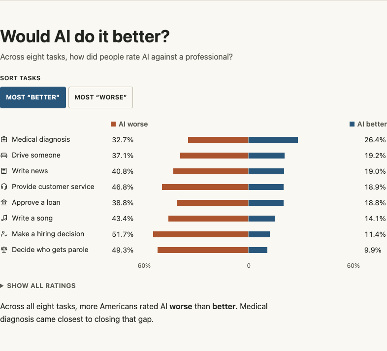
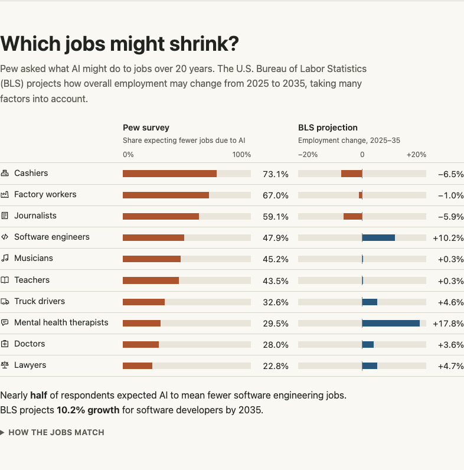
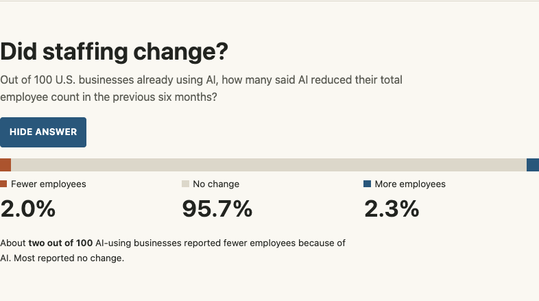
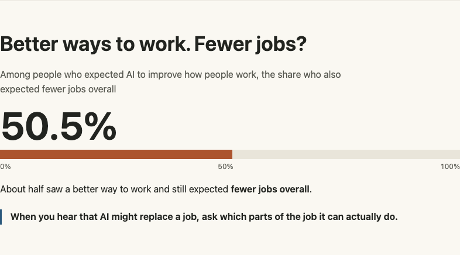

[Home](./) · [Part I](final-project-part-one.html) · [Part III](final-project-part-three.html)

# Final project · Part II

## Better Than Us, or Replacing Us?

AI might do one part of a job well. What does that tell us about the future of the whole job? I’m exploring that question for readers who follow AI and work, especially students thinking about their first jobs.

**[Open the interactive draft →](better-than-us.html)**

## Storyboard

1. **Start with what people think AI can do.** Readers can [sort eight tasks](better-than-us.html#tasks-title), [compare their outlook for a field with how they rated a task](better-than-us.html#sector-title), and then [see four occupations side by side](better-than-us.html#comparison-title). Medical diagnosis ranked highest on “AI better,” yet more people rated AI worse than better at it.
2. **Put expectations next to an employment forecast.** The [ten-occupation comparison](better-than-us.html#jobs-title) puts Pew’s 20-year public expectations alongside BLS’s 2025–2035 projections for total employment. Software is the clearest example of why the two measures are worth seeing side by side.
3. **Show what businesses report doing now.** Readers [compare three AI uses in manufacturing and finance](better-than-us.html#functions-title), then [guess and reveal the staffing result](better-than-us.html#staffing-title) from the Census survey. The staffing question covers the previous six months among businesses using AI.
4. **Return to the people who see both possibilities.** In the [closing chart](better-than-us.html#outlook-title), 50.5% of people who expected AI to improve how people work also expected fewer jobs overall. I want readers to leave asking which parts of a job AI can actually do.

  <a href="better-than-us.html#jobs-title">Employment outlook</a>
  <a href="better-than-us.html#staffing-title">Staffing reveal</a>
  <a href="better-than-us.html#outlook-title">Closing takeaway</a>

## User research

**Audience and recruitment.** My target readers are people curious about AI’s effect on work, especially students starting their careers. I shared the draft with two classmates. For another round I would recruit a student or recent graduate outside the course to see how the story reads without class context.

**Research questions.** Can readers explain the story in their own words? Can they tell the difference between doing a task well and expecting fewer jobs? Where does the interaction help them compare?

**Interview guide for the next round.** “Take a look at the draft at your own pace. Tell me what you’re thinking as you go.”

1. What do you think this story is about? What would you remember from it?
2. What do the medical diagnosis and doctor charts each tell you?
3. How would you compare the four occupations? Was anything in the way?
4. What did you learn from the ending? What would you want clarified?

## Feedback and changes

**Part I instructor feedback.** My instructor suggested using more data to tell a fuller story. I added BLS occupational projections and the Census business survey to bring in an employment outlook and business reports alongside the public survey.

| Interview | What I heard | How I used it |
| --- | --- | --- |
| Classmate 1 | Keeping doctors fixed and switching one other occupation at a time made comparisons harder than they needed to be. The classmate also wanted a clear takeaway to end on. | I put all four occupations in a 2×2 grid with the same scale. The story now ends with the 50.5% chart and a short question readers can carry with them. |
| Classmate 2 | The strong relative rating for medical diagnosis seemed to clash with the lower expectation of fewer doctor jobs. | I added a note that diagnosis is one part of a doctor’s job. The two survey questions now appear together in the walkthrough so readers can see what each percentage measures. |

Both interviews pointed to places where readers had to make a connection on their own. One surfaced a problem with the controls and the ending. The other surfaced a problem with how the story explained the medical example. The findings above cover two interviews so far.

**What I’ll test in Part III.** I’ll check whether a first-time reader can explain the takeaway and distinguish the public survey, the employment projection, and the short-term business report. I’ll also check whether the manufacturing example and the staffing reveal feel connected when read in order.

## Sources

- Pew Research Center. (n.d.). [*American Trends Panel Wave 152*](https://www.pewresearch.org/dataset/american-trends-panel-wave-152/) [Data set]. Survey conducted August 12–18, 2024.
- U.S. Bureau of Labor Statistics. (2026). [*Occupational projections, 2025–35, and worker characteristics, 2025*](https://www.bls.gov/emp/tables/occupational-projections-and-characteristics.htm) [Table 1.2]. The factory-worker comparison uses the [manufacturing National Employment Matrix](https://data.bls.gov/projections/nationalMatrix?ioType=i&queryParams=31-330).
- U.S. Census Bureau. (2026). [*Business Trends and Outlook Survey, 2026 AI Supplement*](https://www.census.gov/hfp/btos/downloads/AI_Supplement_Table_2026.xlsx) [Data set]. Fielded November 17, 2025 to February 8, 2026.

## AI acknowledgement

I used Codex to write the HTML for the interactive charts and webpage.

[← Part I](final-project-part-one.html) · [Home](./) · [Part III →](final-project-part-three.html)
